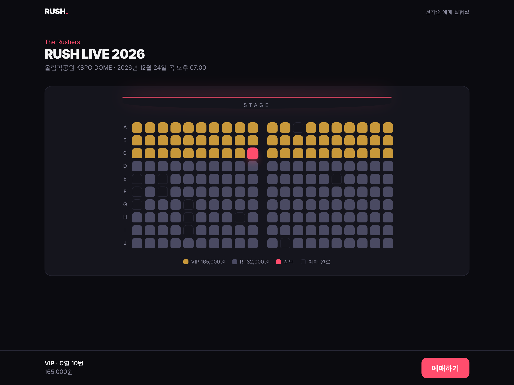
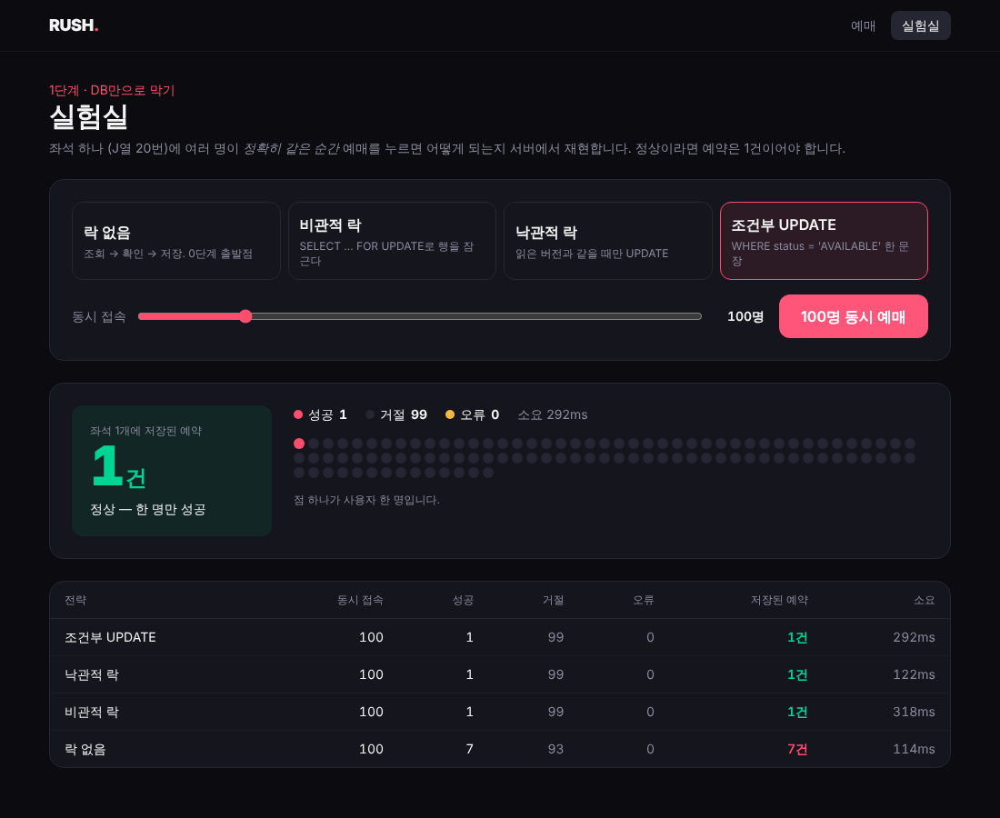

# RUSH — 선착순 예매 실험실

콘서트 티켓 예매처럼 **같은 좌석에 요청이 한꺼번에 몰리는 상황**을 직접 만들고,
단계별로 고쳐 가며 그 과정을 수치로 기록하는 프로젝트입니다.

> 4년간 B2G SI에서 일하며 다뤄 볼 일이 없었던 동시성·트래픽·운영 문제를
> 직접 재현하고 측정하고 고쳐 보는 것이 목표입니다.
> 진행 기록은 [imjaewoo.dev](https://imjaewoo.dev)에 회고로 남깁니다.



## 지금 어디까지 왔나

**0단계 — 문제 재현** ✅

락 없이 "조회 → 확인 → 저장"만 한 예매 로직에 100명이 같은 좌석으로 동시에 요청하면:

```
[NONE] 요청 100건 → 성공 10건, 좌석 1개에 저장된 예약 10건
```

한 좌석이 10번 팔립니다. 10은 HikariCP 기본 커넥션 풀 크기와 같습니다.
(재현 테스트: `backend/src/test/.../NoLockSeatReserverConcurrencyTest.java`)

**1단계 — DB만으로 막기** (진행 중)

비관적 락, 낙관적 락, 조건부 UPDATE 세 전략 모두 같은 조건에서 예약이 1건으로 막힙니다.
`/lab` 실험실 화면에서 전략과 동시 접속 수를 골라 직접 비교할 수 있습니다.



전체 계획은 [docs/ROADMAP.md](docs/ROADMAP.md)에 있습니다.

## 기술 스택

| 영역 | 사용 기술 |
|---|---|
| 백엔드 | Java 21, Spring Boot 4, Spring Data JPA, Flyway |
| DB | PostgreSQL 17 |
| 테스트 | JUnit 5, Testcontainers |
| 프론트 | React 19, TypeScript, Vite, Tailwind CSS 4 |
| 인프라 | Docker Compose, GitHub Actions |
| 예정 | Redis, Kafka, k6, Prometheus, Grafana |

## 실행하기

필요한 것: JDK 21, Node 22, Docker

```bash
# 1. DB
docker compose up -d

# 2. 백엔드 (http://localhost:8080)
cd backend && ./gradlew bootRun

# 3. 프론트 (http://localhost:5173)
cd frontend && npm install && npm run dev
```

테스트는 Testcontainers로 PostgreSQL을 띄우므로 Docker만 켜져 있으면 됩니다.

```bash
cd backend && ./gradlew test
```

## API

| 메서드 | 경로 | 설명 |
|---|---|---|
| GET | `/api/concerts` | 공연 목록 (잔여석 포함) |
| GET | `/api/concerts/{id}/seats` | 좌석 목록 |
| POST | `/api/reservations?strategy=NONE` | 예매 `{ seatId, userId }` |
| GET | `/api/admin/concerts/{id}/stats` | 예약 건수, 초과 예매된 좌석 수 |
| POST | `/api/admin/concerts/{id}/reset` | 실험 초기화 |
| POST | `/api/admin/experiments` | 동시 예매 실험 `{ seatId, strategy, users }` |

`strategy`는 `NONE`, `PESSIMISTIC`, `OPTIMISTIC`, `CONDITIONAL_UPDATE` 중 하나입니다.

## 구조

```
backend/   Spring Boot API
  concert/       공연·좌석 조회
  reservation/   예매. SeatReserver 구현체 하나가 동시성 전략 하나
  experiment/    N명 동시 예매를 서버 안에서 재현 (실험실 화면, 테스트 공용)
frontend/  React 예매 화면
docs/      로드맵, 측정 기록, 스크린샷
```
