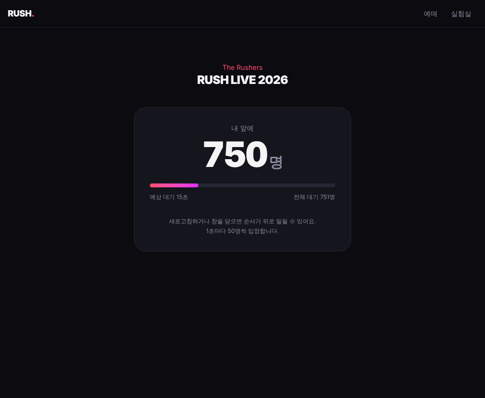

# RUSH — 선착순 예매 실험실

콘서트 티켓 예매처럼 **같은 좌석에 요청이 한꺼번에 몰리는 상황**을 직접 만들고,
단계별로 고쳐 가며 그 과정을 수치로 기록하는 프로젝트입니다.

> 4년간 B2G SI에서 일하며 다뤄 볼 일이 없었던 동시성·트래픽·운영 문제를
> 직접 재현하고 측정하고 고쳐 보는 것이 목표입니다.
> 진행 기록은 [imjaewoo.dev](https://imjaewoo.dev)에 회고로 남깁니다.


## 지금 어디까지 왔나

**0단계 — 문제 재현** ✅

락 없이 "조회 → 확인 → 저장"만 한 예매 로직에 100명이 같은 좌석으로 동시에 요청하면:

```
[NONE] 요청 100건 → 성공 10건, 좌석 1개에 저장된 예약 10건
```

한 좌석이 10번 팔립니다. 10은 HikariCP 기본 커넥션 풀 크기와 같습니다.
(재현 테스트: `backend/src/test/.../NoLockSeatReserverConcurrencyTest.java`)

**1단계 — DB만으로 막기** ✅

비관적 락, 낙관적 락, 조건부 UPDATE, 유니크 키 선점 네 전략 모두
"한 좌석에 몰리게"와 "200석에 흩어지게" 두 시나리오에서 중복 판매 0건입니다.
`/lab` 실험실 화면에서 시나리오·전략·동시 접속 수를 골라 직접 비교할 수 있습니다.


**2단계 — 측정 환경** (진행 중)

k6로 5,000석 공연에 20,000건을 보내고 Prometheus + Grafana로 지켜봅니다.
처음엔 *DB 커넥션 풀 대기*가 병목처럼 보였지만, 풀을 10→50으로 늘려도 처리량은 그대로였고 p99는 오히려 나빠졌습니다. 진짜 한계는 CPU였습니다. → [측정 결과](docs/ROADMAP.md), [실행 방법](load-test/README.md)


**3단계 — Redis** (진행 중)

Redis 분산 락을 직접 구현해 DB 락과 비교했고, Sorted Set으로 대기열을 만들었습니다.
대기열이 켜진 공연은 대기실에서 "내 앞에 N명"을 기다린 뒤에만 예매할 수 있습니다.



전체 계획은 [docs/ROADMAP.md](docs/ROADMAP.md)에 있습니다.

## 기술 스택

| 영역 | 사용 기술 |
|---|---|
| 백엔드 | Java 21, Spring Boot 4, Spring Data JPA, Flyway |
| DB | PostgreSQL 17 |
| 테스트 | JUnit 5, Testcontainers |
| 프론트 | React 19, TypeScript, Vite, Tailwind CSS 4 |
| 측정 | k6, Micrometer, Prometheus, Grafana |
| 인프라 | Docker Compose, GitHub Actions |
| 캐시·대기열 | Redis 7.4 |
| 예정 | Kafka |

## 실행하기

필요한 것: JDK 21, Node 22, Docker

```bash
# 1. DB, Redis
docker compose up -d

# 2. 백엔드 (http://localhost:8080)
cd backend && ./gradlew bootRun

# 3. 프론트 (http://localhost:5173)
cd frontend && npm install && npm run dev
```

테스트는 Testcontainers로 PostgreSQL을 띄우므로 Docker만 켜져 있으면 됩니다.

```bash
cd backend && ./gradlew test
```

## API

| 메서드 | 경로 | 설명 |
|---|---|---|
| GET | `/api/concerts` | 공연 목록 (잔여석 포함) |
| GET | `/api/concerts/{id}/seats` | 좌석 목록 |
| POST | `/api/reservations?strategy=NONE` | 예매 `{ seatId, userId }` |
| GET | `/api/admin/concerts/{id}/stats` | 예약 건수, 초과 예매된 좌석 수 |
| POST | `/api/admin/concerts/{id}/reset` | 실험 초기화 |
| POST | `/api/admin/experiments` | 동시 예매 실험 `{ seatId, strategy, scenario, users }` |
| POST | `/api/queue/{concertId}` | 대기열 입장 → `{ token }` |
| GET | `/api/queue/{concertId}/{token}` | 내 순번 `{ state, ahead, waiting }` |
| POST | `/api/admin/queue/{concertId}/open?bots=N` | 대기열 켜기 + 가상 대기자 N명 |
| POST | `/api/admin/queue/{concertId}/close` | 대기열 끄기 |

`strategy`는 `NONE`, `PESSIMISTIC`, `OPTIMISTIC`, `CONDITIONAL_UPDATE`, `UNIQUE_KEY`, `REDIS_LOCK` 중 하나, `scenario`는 `HOT`(한 좌석) 또는 `SPREAD`(공연 전체 좌석)입니다.

## 구조

```
backend/   Spring Boot API
  concert/       공연·좌석 조회
  reservation/   예매. SeatReserver 구현체 하나가 동시성 전략 하나
  experiment/    N명 동시 예매를 서버 안에서 재현 (실험실 화면, 테스트 공용)
  queue/         Redis 대기열과 1초마다 입장시키는 스케줄러
frontend/  React 예매 화면
load-test/ k6 부하 테스트
monitoring/ Prometheus, Grafana 설정과 대시보드
docs/      로드맵, 측정 기록, 스크린샷
```
