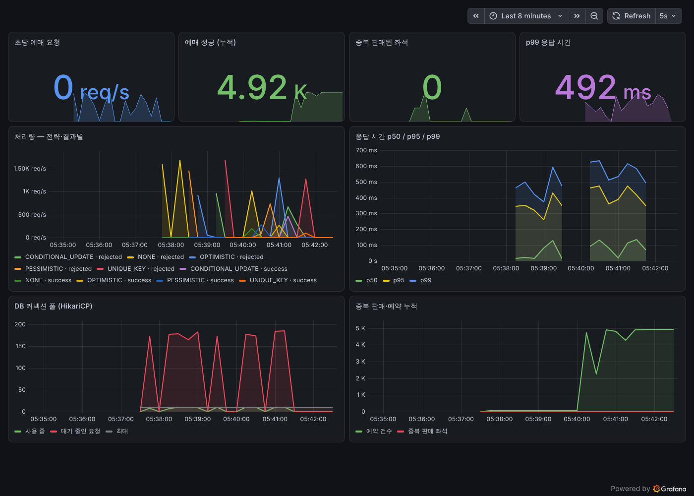
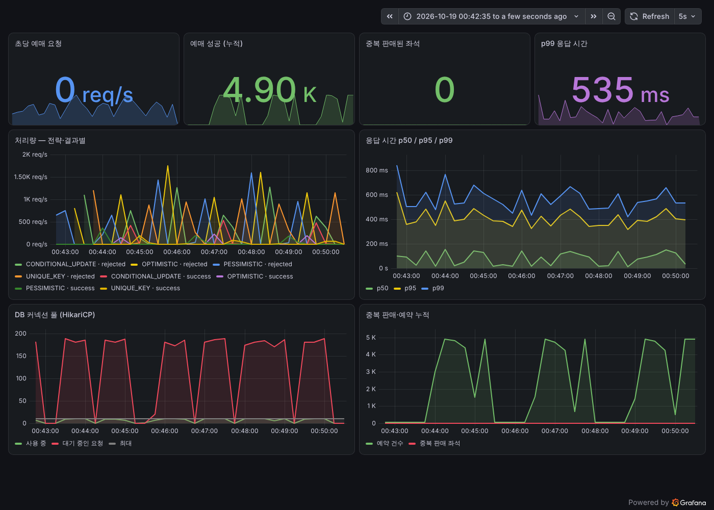
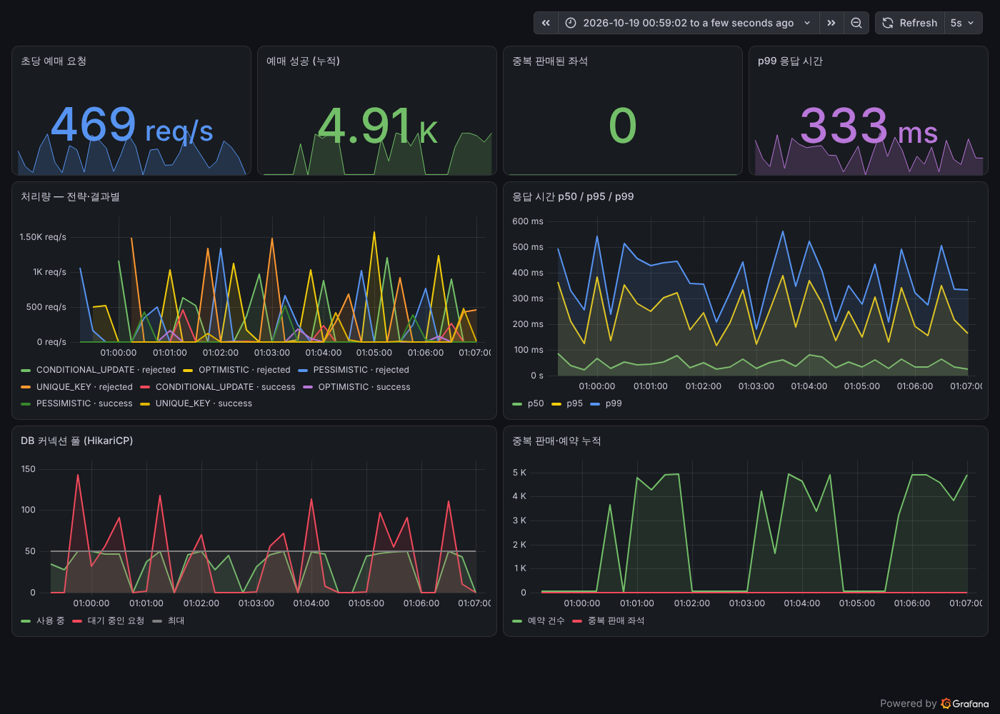

# 로드맵

각 단계는 **같은 시나리오를 같은 조건에서 측정**하고, 전후 수치를 남기는 것을 원칙으로 합니다.
단계마다 블로그 글 한 편을 목표로 합니다.

## 0단계 — 문제 재현 ✅

- [x] 공연·좌석·예약 도메인, Flyway 마이그레이션, 시드 데이터(200석)
- [x] 락 없는 예매(`LockStrategy.NONE`)
- [x] 100명 동시 요청 재현 테스트 (Testcontainers)
- [x] 예매 화면: 공연 목록, 좌석 배치도
- [x] GitHub Actions CI

**결과:** 요청 100건 → 한 좌석에 예약 10건. 10은 커넥션 풀 크기와 같다.

📝 글감: *100명이 동시에 예매하면 생기는 일 — 초과 예매를 일부러 만들어 보기*

## 1단계 — DB만으로 막기 ✅

- [x] 비관적 락 (`SELECT ... FOR UPDATE`)
- [x] 낙관적 락 (버전 비교 UPDATE). JPA `@Version`은 NONE 전략까지 바꿔 버려서 직접 비교
- [x] 조건부 UPDATE (`update seat set status='RESERVED' where id=? and status='AVAILABLE'`)
- [x] 실험실 화면 — 전략과 동시 접속 수를 골라 서버에서 재현하고 결과 비교
- [x] 같은 테스트로 세 전략 모두 예약 1건 검증
- [x] 유니크 키 선점 (`seat_claim.seat_id` PK + `on conflict do nothing`). reservation에 직접 unique를 걸면 NONE 재현까지 막혀서 테이블 분리
- [x] 시나리오 비교 — 한 좌석에 몰리게(HOT) / 200석에 흩어지게(SPREAD)

**결과:** 네 전략 모두 HOT·SPREAD에서 중복 판매 0건. 락 없음은 SPREAD 1,000명에서도 8건 중복 판매.

📝 글감: *DB 락 세 가지를 같은 조건에서 비교해 보니*

## 2단계 — 측정 환경 (진행 중)

- [x] k6 부하 시나리오 — HOT(앞줄 50석) / SPREAD(5,000석), 20,000건 x 200 VU
- [x] Micrometer `rush.reservation` 타이머(전략·결과별), 중복 판매 게이지
- [x] Prometheus + Grafana 대시보드 (처리량, p50/p95/p99, 커넥션 풀, 중복 판매)
- [x] 1단계 전략들을 TPS·p95·p99로 다시 측정
- [x] 커넥션 풀 크기 10 / 30 / 50으로 다시 측정 — 병목이 락인지 풀인지 확인
- [x] 같은 조건 3회 반복, 중앙값으로 비교

**발견 1:** 풀 10에서는 커넥션 10개가 꽉 차고 대기 요청이 180~190개까지 쌓였다.

**발견 2:** 그래서 풀을 30, 50으로 늘렸지만 처리량은 그대로였고, 50에서는 p99가 오히려 나빠졌다
(HOT·낙관적 락 472ms → 804ms). 대기 요청은 줄었지만(최대 143) CPU 사용률이 측정 내내 95~100%였다.
k6·앱·DB가 4코어 한 대를 나눠 쓰는 환경에서 진짜 한계는 CPU였고, 커넥션 대기는 그 증상이었다.
커넥션을 늘리면 DB 안에서 경합과 문맥 전환만 늘어난다 — HikariCP 문서의 "코어 수 x 2 정도" 가이드와 맞는 결과.

**다음에 확인할 것:** k6를 다른 머신으로 분리하거나 코어를 늘린 환경에서 같은 측정.

📝 글감: *단위 테스트로는 안 보이던 것 — k6로 다시 재 보기*

## 3단계 — Redis (진행 중)

- [x] Redis 분산 락 (`SET NX PX` + Lua 해제) — 라이브러리 없이 직접 구현, DB 락과 비교
- [x] 대기열(Sorted Set) — 입장 순번, 초당 50명 입장, 입장 후 5분 유효
- [x] 대기열이 켜진 공연은 입장 토큰(`X-Queue-Token`) 없이 예매 불가 (403)
- [x] 대기실 화면 — "내 앞에 N명", 진행 막대, 예상 대기 시간. 실험실에서 가상 대기자 투입
- [ ] 좌석 임시 점유(5분) + 만료 시 자동 반환

**Redis 락 구현에서 배운 것:** 락 해제가 트랜잭션 커밋보다 먼저 일어나면, 다음 사람이 아직 커밋 안 된
AVAILABLE을 읽어 중복 판매가 생긴다. 그래서 트랜잭션은 락 안쪽 메서드에만 두었다.

**k6 비교 (풀 10, 3회 중앙값):**

| 시나리오 | 전략 | 처리량 | p99 |
|---|---|---|---|
| HOT | PESSIMISTIC | 1552 req/s | 504ms |
| HOT | UNIQUE_KEY | 1680 req/s | 447ms |
| HOT | REDIS_LOCK | 1339 req/s | **285ms** |
| SPREAD | PESSIMISTIC | 1294 req/s | 607ms |
| SPREAD | UNIQUE_KEY | 1332 req/s | 601ms |
| SPREAD | REDIS_LOCK | **913 req/s** | 483ms |

HOT에서는 락을 못 잡은 요청이 DB까지 가지 않고 바로 거절돼 p99가 가장 낮았다.
SPREAD에서는 경합이 적어 그 이점이 사라지고, 요청마다 Redis 왕복 두 번이 더해져 처리량이 30% 줄었다.
Redis가 같은 4코어 머신의 CPU를 나눠 쓴 영향도 있다. (REDIS_LOCK은 다른 전략들과 다른 날 측정)

📝 글감: *대기열을 붙이니 DB가 편해졌다*

## 4단계 — 비동기와 정합성

- [ ] Kafka로 결제·예약 확정 비동기 처리
- [ ] 트랜잭션 아웃박스 패턴
- [ ] 멱등성 키 — 같은 요청이 두 번 와도 한 번만 처리

📝 글감: *메시지가 두 번 오면? — 아웃박스와 멱등성*

## 5단계 — 장애 실험

- [ ] Redis 다운, Kafka 지연, DB 커넥션 고갈 상황 재현
- [ ] 타임아웃·서킷 브레이커·폴백

📝 글감: *Redis가 죽으면 예매도 죽을까*

## 6단계 — 화면 완성

- [ ] 대기열 화면 (내 앞 N명, 실시간 감소)
- [ ] 좌석 실시간 반영 (폴링 → SSE)
- [ ] 관제 대시보드: 전략 전환, TPS·대기열·초과 예매 실시간 그래프
- [ ] 결제·예매 완료 화면

📝 글감: *폴링에서 SSE로* / *전체 회고*

## 측정 기록

| 날짜 | 단계 | 전략 | 조건 | 결과 |
|---|---|---|---|---|
| 2026-10-16 | 0 | NONE | 100명 → 좌석 1개, 스레드 32, 풀 10 | 성공 10건 (초과 예매 9건) |
| 2026-10-16 | 1 | NONE | 실험실, 같은 조건 | 예약 7건, 114ms |
| 2026-10-16 | 1 | PESSIMISTIC | 실험실, 같은 조건 | 예약 1건, 318ms |
| 2026-10-16 | 1 | OPTIMISTIC | 실험실, 같은 조건 | 예약 1건, 122ms |
| 2026-10-16 | 1 | CONDITIONAL_UPDATE | 실험실, 같은 조건 | 예약 1건, 292ms |

| 2026-10-17 | 1 | NONE | SPREAD 1,000명 → 200석 | 중복 판매 8건, 664ms |
| 2026-10-17 | 1 | 4개 전략 | SPREAD 1,000명 → 200석 | 중복 판매 0건, 464~650ms |
| 2026-10-17 | 1 | UNIQUE_KEY | HOT 100명 → 좌석 1개 | 예약 1건, 108ms |

### 2단계 k6 (2026-10-17, 200 VU, 20,000건, 풀 10, 4코어 한 대에 k6·앱·DB 동시 실행, 1회 측정)

| 시나리오 | 전략 | 처리량 (req/s) | p50 | p95 | p99 | 예매 성공 | 중복 판매 좌석 |
|---|---|---|---|---|---|---|---|
| HOT | NONE | 1655 | 70ms | 356ms | 501ms | 67 | **17** |
| HOT | PESSIMISTIC | 1540 | 80ms | 375ms | 516ms | 50 | 0 |
| HOT | OPTIMISTIC | 1675 | 61ms | 348ms | 479ms | 50 | 0 |
| HOT | CONDITIONAL_UPDATE | 1297 | 137ms | 429ms | 571ms | 50 | 0 |
| HOT | UNIQUE_KEY | 1718 | 36ms | 340ms | 482ms | 50 | 0 |
| SPREAD | NONE | 1198 | 121ms | 462ms | 638ms | 4932 | **8** |
| SPREAD | PESSIMISTIC | 1332 | 110ms | 432ms | 589ms | 4894 | 0 |
| SPREAD | OPTIMISTIC | 1447 | 66ms | 417ms | 571ms | 4912 | 0 |
| SPREAD | CONDITIONAL_UPDATE | 1253 | 139ms | 449ms | 603ms | 4911 | 0 |
| SPREAD | UNIQUE_KEY | 1427 | 113ms | 372ms | 519ms | 4924 | 0 |

### 2단계 커넥션 풀 크기 비교 (2026-10-19, 200 VU, 20,000건, 3회 중앙값)

처리량 (req/s) · p99

| 시나리오 | 전략 | 풀 10 | 풀 30 | 풀 50 |
|---|---|---|---|---|
| HOT | PESSIMISTIC | 1552 · 504ms | 1474 · 448ms | 1344 · 665ms |
| HOT | OPTIMISTIC | 1628 · 472ms | 1601 · 448ms | 1521 · 804ms |
| HOT | CONDITIONAL_UPDATE | 1199 · 621ms | 1243 · 603ms | 1139 · 596ms |
| HOT | UNIQUE_KEY | 1680 · 447ms | 1596 · 466ms | 1591 · 727ms |
| SPREAD | PESSIMISTIC | 1294 · 607ms | 1382 · 561ms | 1281 · 619ms |
| SPREAD | OPTIMISTIC | 1268 · 606ms | 1346 · 556ms | 1253 · 664ms |
| SPREAD | CONDITIONAL_UPDATE | 1196 · 639ms | 1132 · 630ms | 1113 · 612ms |
| SPREAD | UNIQUE_KEY | 1332 · 601ms | 1318 · 526ms | 1337 · 696ms |

72회 실행 모두 중복 판매 0건. CPU 사용률 중앙값 95%, 최대 99.8%.

| 풀 10 | 풀 50 |
|---|---|
|  |  |

> 소요 시간은 아직 한 번씩 잰 값이라 참고용입니다. 2단계에서 k6로 반복 측정합니다.
